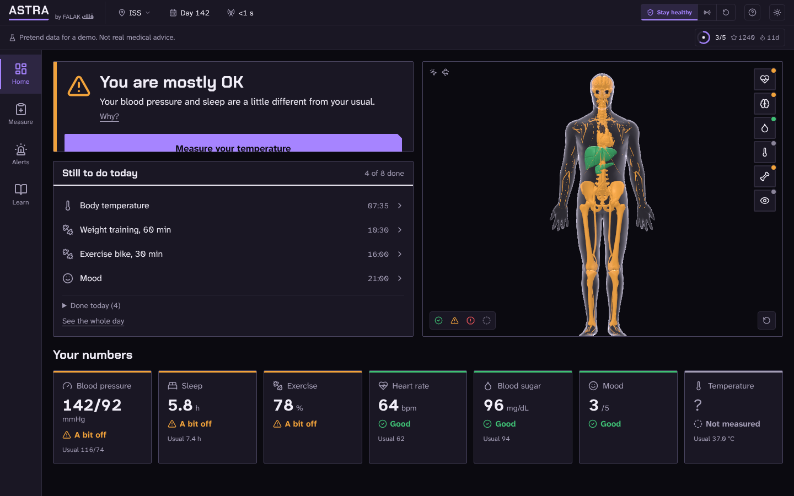
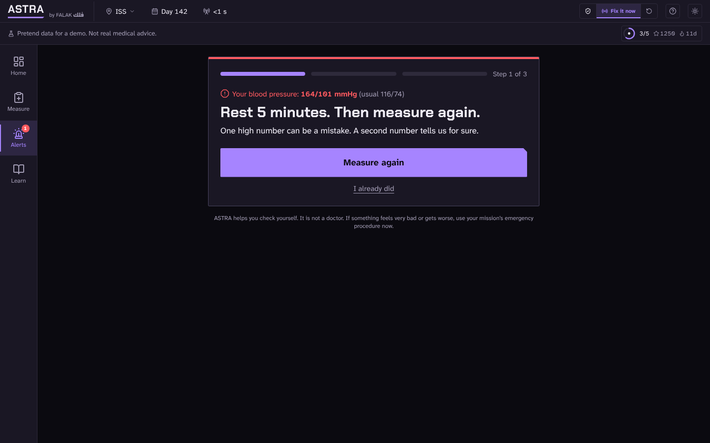

# ASTRA · by FALAK (فلك)

Astronaut health-monitoring dashboard for NASA Space Apps 2026, *Create Health Monitoring Software for Astronauts on Space Missions*.
**Demo data only: synthetic astronaut, not a medical record.**

## Run

```bash
npm install
npm run dev        # http://localhost:5173
npm run build      # static build in dist/
npm run preview
```

Node 20+ recommended.

## Presenter controls (hidden)

| Key | Action |
|---|---|
| `Shift+D` | Advance the simulated mission clock. With an open event in Recover: 1st press logs a +30 min follow-up (148/94), 2nd press jumps to next morning 07:40 and logs 124/78, which closes the event and awards "Back in Orbit". |
| `Shift+R` | Reset the demo to Mission Day 142, 08:45 UTC (synthetic history restored, no reload needed). |

## 90-second demo path



0. First visit: a 3-screen guide explains the four labels (Good, A bit off, Act now, Not measured). Reopen it with the **?** button.
1. Home answers three questions: how am I, why, and what do I do now. One big button, then "Still to do today", then "Your numbers". Click any number for its details.
2. Click the heart icon on the body (or the heart button on the right of it): the panel explains heart and blood flow in plain words.
3. **Measure** asks one question per screen. Open Blood pressure, type 164 and 101. ASTRA shows **Act now** before you save. Press **Save**: the heart turns red.
4. Press **Start the 3 easy steps**. **Alerts** shows one step at a time: measure again, how do you feel, tell the doctor. Switch the location to Mars Transit first to see the message delay. +40 Honest Reporter.

   

5. `Shift+D` twice: the heart goes orange, then green, and the alert closes.
6. **Learn**: every limit in plain words, why it matters in space, and sources.

The menu has 4 items: Home, Measure, Alerts, Learn. The day plan opens from "See the whole day" on Home, past days from "See all past days" in a number's details, and points from the ring in the header.

## Where things live

| Concern | File |
|---|---|
| Status language (labels, icons, colours) | `src/lib/status.ts` |
| Alert rules as data (`DEMO · PENDING VALIDATION`) | `src/lib/rules.ts` |
| Body-system mapping and guidance copy | `src/lib/systems.ts` |
| Data adapter (only file that knows source column names) | `src/data/adapter.ts` |
| Synthetic history generator (seeded) | `scripts/gen-demo.ts` → `src/data/demo/history.raw.json` |
| 3D scene | `src/three/BodyScene.tsx`, mesh-name contract in `src/three/bodyModel.ts` |
| 2D fallback | `src/components/BodyMap2D.tsx` |
| Gamification | `src/lib/gamification.ts`, actions in `src/store/useAstra.ts` |

## Rebuilding the body model

```bash
python3 -m venv .bpy && .bpy/bin/pip install bpy==5.3.0
BPY_PYTHON=.bpy/bin/python tools/build_body.sh /path/to/workdir
```

Downloads BodyParts3D (~65 MB), builds `public/models/astra_body.glb` (~1.0 MB, ~150k triangles, meshopt) and prints `gltf-transform inspect`. The app checks for the mesh names `shell, sys_cardio, sys_neuro, sys_metabolic, sys_msk, sys_ocular, sys_immune` and falls back to the 2D body map, naming the missing meshes, if any are absent.

`VITE_DEV_PLACEHOLDER_BODY=1 npm run dev` renders primitive placeholder geometry (development only, ignored in production builds).

## Licence

Apache-2.0. Third-party licences, including the anatomy model attribution, are in `CREDITS.md`.
